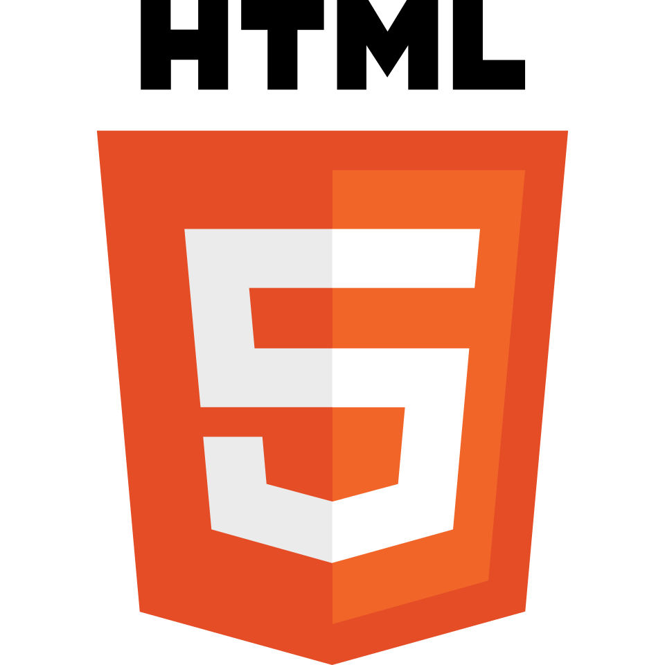
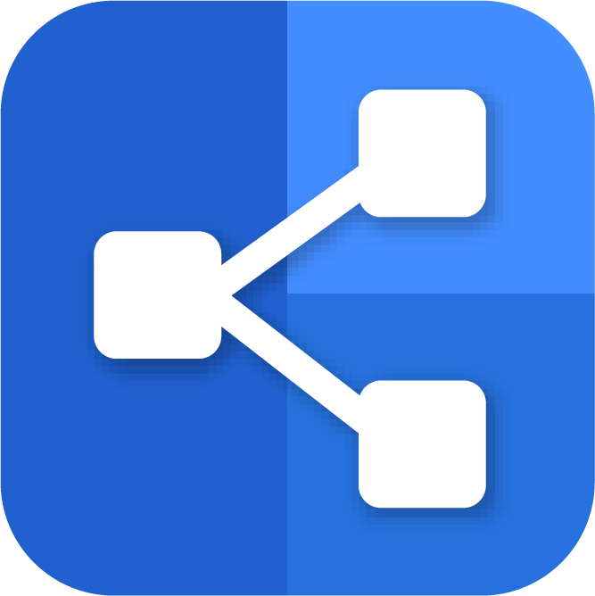

# Vida+Fácil

## Sobre o projeto

O Vida+Fácil é uma plataforma web voltada à saúde preventiva e ao bem-estar de pacientes da terceira idade, desenvolvida para a startup fictícia InovaVida Digital.

O projeto tem como objetivo facilitar o agendamento de atendimentos, o acompanhamento de indicadores de saúde e o acesso a conteúdos educativos, promovendo acessibilidade, autonomia e inclusão digital.

## Funcionalidades previstas

* Cadastro e autenticação de usuários.

* Cadastro de pacientes e profissionais de saúde.

* Agendamento de atendimentos.

* Consulta de horários disponíveis.

* Registro de pressão arterial e glicemia.

* Dashboard de indicadores de saúde.

* Histórico de registros.

* Acesso a conteúdos educativos.

* Gerenciamento de perfil.

* Gerenciamento de disponibilidade profissional.


## Ferramentas utilizadas

### Figma


Figma é um editor gráfico de vetor e prototipagem de projetos de design baseado principalmente no navegador web, com ferramentas offline adicionais para aplicações desktop. É um software focado no desenvolvimento de sistemas de design gráfico, prototipagem de interface gráfica de usuário e desenvolvimento de UI/UX (User Interface eXperience ou experiência da interface com o usuário), permitindo também o desenvolvimento colaborativo em tempo real com outros usuários remotamente.

### Draw.io


Diagrams.net (anteriormente draw.io) é um aplicativo de desenho de gráficos utilizado para projetar e exportar muitos tipos de diagramas, incluindo diagramas de circuitos, plantas baixas, fluxogramas, infográficos, mapas mentais e designs UML. É possível acessar o software tanto pelo aplicativo para desktop ou pela web através do site.

### HTML5


HTML (abreviação para a expressão inglesa HyperText Markup Language, que significa: "Linguagem de Marcação de Hipertexto") é uma linguagem de marcação utilizada na construção de páginas na Web. Documentos HTML podem ser interpretados por navegadores.

### CSS


Cascading Style Sheets (abreviado CSS) é um mecanismo para adicionar estilos (cores, fontes, espaçamento, etc.) a uma página web, aplicado diretamente nas tags HTML ou ficar contido dentro das tags style. Também é possível, adicionar estilos adicionando um link para um arquivo CSS que contém os estilos.

### MariaDB


MariaDB é um sistema de gerenciamento de banco de dados relacional (RDBMS) de código aberto que compartilha uma herança comum com o MySQL, do qual foi bifurcado em 2009 pelos desenvolvedores originais do MySQL após a aquisição da Sun Microsystems pela Oracle Corporation

### Docker


Docker é uma plataforma que permite empacotar e executar aplicações em contêineres, mantendo seu funcionamento consistente em diferentes ambientes.
Docker é um conjunto de produtos que usa virtualização em nível de sistema operacional para entregar software em pacotes chamados contêineres. O Docker automatiza a implantação de aplicativos em contêineres leves, permitindo que eles sejam executados de forma consistente em diferentes ambientes de computação.

### HeidiSQL


HeidiSQL é uma ferramenta de administração gratuita e de código aberto para MariaDB, MySQL, bem como Microsoft SQL Server, PostgreSQL e SQLite.

### Dbdiagram.io


Dbdiagram.io é uma ferramenta simples e gratuita para desenhar diagramas de banco de dados (ERDs) digitando código DSL. dbdiagram usa o popular DBML (Database Markup Language).

### Java Script


JavaScript (frequentemente abreviado como JS) é uma linguagem de programação interpretada estruturada, de script em alto nível com tipagem dinâmica fraca e multiparadigma (protótipos, orientado a objeto, imperativo e funcional).

### NodeJs


Node.js é um software de código aberto, multiplataforma, baseado no interpretador V8 do Google e que permite a execução de códigos JavaScript fora de um navegador web.

### Swagger 


Swagger é um conjunto de ferramentas para desenvolvedores de API da SmartBear Software[1] e uma especificação anterior na qual a Especificação OpenAPI é baseada

## Tutorial Módulo D - Atenção!

A API usa Node.js, Express e o driver `mysql2`. O cadastro cria uma conta com perfil de paciente. O login verifica a senha com bcrypt e emite um token JWT válido por uma hora. O contrato OpenAPI está em [openapi.json](vida_facil/vida_mais_facil_api/openapi.json).

### Preparar o banco

Com o MySQL em execução, execute [01_schema.sql](docs/01_schema.sql) para criar o banco e as tabelas. Confira se a primeira instrução termina em ponto e vírgula (`CREATE DATABASE vida_mais_facil;`). Em seguida, selecione o banco com `USE vida_mais_facil;` e execute [02_dados.sql](docs/02_dados.sql) para carregar os dados de demonstração.

### Instalar e iniciar a API

Use Node.js 24 LTS ou uma versão posterior. No PowerShell, a partir da raiz do repositório, execute:

```powershell
cd .\vida_facil\vida_mais_facil_api
npm install express@5 mysql2@3 bcryptjs@3 jsonwebtoken@9 swagger-ui-express@5
```

Crie o arquivo `.env` na mesma pasta do `package.json`. Preencha os dados da sua conexão:

```dotenv
DB_HOST=127.0.0.1
DB_PORT=3306
DB_USER=seu_usuario_mysql
DB_PASSWORD="sua_senha_mysql"
DB_NAME=vida_mais_facil
JWT_SECRET=seu_segredo_gerado
```

Gere o segredo com este comando:

```powershell
node -e "console.log(require('node:crypto').randomBytes(32).toString('hex'))"
```

Use o valor retornado em `JWT_SECRET`, salve o `.env` e mantenha esse arquivo fora do Git e do pacote de entrega. Na pasta da API, execute:

```powershell
npm start
```

Com o servidor em execução, abra o [Swagger local](http://127.0.0.1:3000/docs/).

### Testar no Swagger

Em cada operação, clique em **Try it out**, preencha os campos, clique em **Execute** e confira **Server response**.

1. Em `POST /cadastro`, use um CPF fictício de 11 dígitos e um e-mail ainda livre. Espere **201**.
2. Em `POST /login`, use o e-mail e a senha desse cadastro. Espere **200** e insira o valor do campo `token` em **Authorize**, sem o prefixo `Bearer`.
3. Em `POST /agendamentos`, informe um `profissionalId` existente em `profissionais.usuario_id` e uma `dataHora` em UTC, como `2026-12-10T17:00:00Z`. Espere **201** e anote o ID do agendamento.
4. Em `GET /agendamentos`, espere **200** e confira o registro na lista.
5. Em `PUT /agendamentos/{id}`, use o ID anotado, informe o profissional e mude o horário. Espere **200**.
6. Em `DELETE /agendamentos/{id}`, use o mesmo ID. Espere **204**. Um novo GET deve mostrar `stats: "Cancelado"`. O horário fica disponível para outro agendamento.

## Licença MIT 
Copyright © 2026

É concedida permissão, gratuitamente, a qualquer pessoa que obtenha uma cópia deste software e arquivos de documentação associados (o “Software”), para negociar o Software sem restrições, incluindo, sem limitação, os direitos de usar, copiar, modificar, mesclar, publicar, distribuir, sublicenciar e/ou vender cópias do Software, e para permitir que as pessoas a quem o Software é fornecido o façam, sujeito às seguintes condições:

O aviso de direitos autorais acima e este aviso de permissão deverão ser incluídos em todas as cópias ou partes substanciais do Software.

