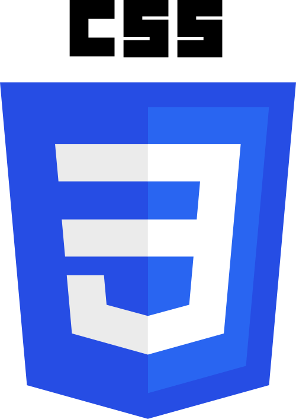

# Vida+Fácil

## Sobre o projeto

O Vida+Fácil é uma plataforma web voltada à saúde preventiva e ao bem-estar de pacientes da terceira idade, desenvolvida para a startup fictícia InovaVida Digital.

O projeto tem como objetivo facilitar o agendamento de atendimentos, o acompanhamento de indicadores de saúde e o acesso a conteúdos educativos, promovendo acessibilidade, autonomia e inclusão digital.

## Funcionalidades previstas

* Cadastro e autenticação de usuários.

* Cadastro de pacientes e profissionais de saúde.

* Agendamento de atendimentos.

* Consulta de horários disponíveis.

* Registro de pressão arterial e glicemia.

* Dashboard de indicadores de saúde.

* Histórico de registros.

* Acesso a conteúdos educativos.

* Gerenciamento de perfil.

* Gerenciamento de disponibilidade profissional.

## Ferramentas utilizadas

### Figma

Figma é um editor gráfico de vetor e prototipagem de projetos de design baseado principalmente no navegador web, com ferramentas offline adicionais para aplicações desktop. É um software focado no desenvolvimento de sistemas de design gráfico, prototipagem de interface gráfica de usuário e desenvolvimento de UI/UX (User Interface eXperience ou experiência da interface com o usuário), permitindo também o desenvolvimento colaborativo em tempo real com outros usuários remotamente.

### Draw.io

Diagrams.net (anteriormente draw.io) é um aplicativo de desenho de gráficos utilizado para projetar e exportar muitos tipos de diagramas, incluindo diagramas de circuitos, plantas baixas, fluxogramas, infográficos, mapas mentais e designs UML. É possível acessar o software tanto pelo aplicativo para desktop ou pela web através do site.

### HTML5

HTML (abreviação para a expressão inglesa HyperText Markup Language, que significa: "Linguagem de Marcação de Hipertexto") é uma linguagem de marcação utilizada na construção de páginas na Web. Documentos HTML podem ser interpretados por navegadores.

### CSS

Cascading Style Sheets (abreviado CSS) é um mecanismo para adicionar estilos (cores, fontes, espaçamento, etc.) a uma página web, aplicado diretamente nas tags HTML ou ficar contido dentro das tags style. Também é possível, adicionar estilos adicionando um link para um arquivo CSS que contém os estilos.

### MariaDB

MariaDB é um sistema de gerenciamento de banco de dados relacional (RDBMS) de código aberto que compartilha uma herança comum com o MySQL, do qual foi bifurcado em 2009 pelos desenvolvedores originais do MySQL após a aquisição da Sun Microsystems pela Oracle Corporation

### Docker

Docker é uma plataforma que permite empacotar e executar aplicações em contêineres, mantendo seu funcionamento consistente em diferentes ambientes.
Docker é um conjunto de produtos que usa virtualização em nível de sistema operacional para entregar software em pacotes chamados contêineres. O Docker automatiza a implantação de aplicativos em contêineres leves, permitindo que eles sejam executados de forma consistente em diferentes ambientes de computação.

### HeidiSQL

HeidiSQL é uma ferramenta de administração gratuita e de código aberto para MariaDB, MySQL, bem como Microsoft SQL Server, PostgreSQL e SQLite.

### Dbdiagram.io

Dbdiagram.io é uma ferramenta simples e gratuita para desenhar diagramas de banco de dados (ERDs) digitando código DSL. dbdiagram usa o popular DBML (Database Markup Language).

## Licença MIT 
Copyright © 2026

É concedida permissão, gratuitamente, a qualquer pessoa que obtenha uma cópia deste software e arquivos de documentação associados (o “Software”), para negociar o Software sem restrições, incluindo, sem limitação, os direitos de usar, copiar, modificar, mesclar, publicar, distribuir, sublicenciar e/ou vender cópias do Software, e para permitir que as pessoas a quem o Software é fornecido o façam, sujeito às seguintes condições:

O aviso de direitos autorais acima e este aviso de permissão deverão ser incluídos em todas as cópias ou partes substanciais do Software.

