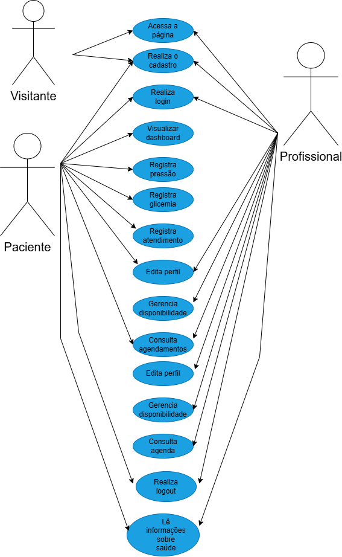
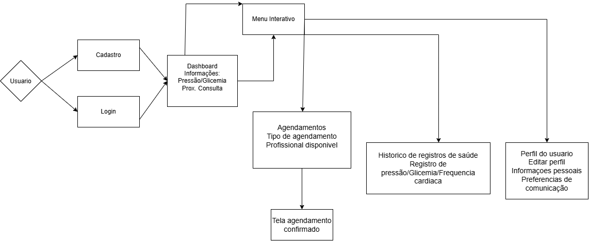
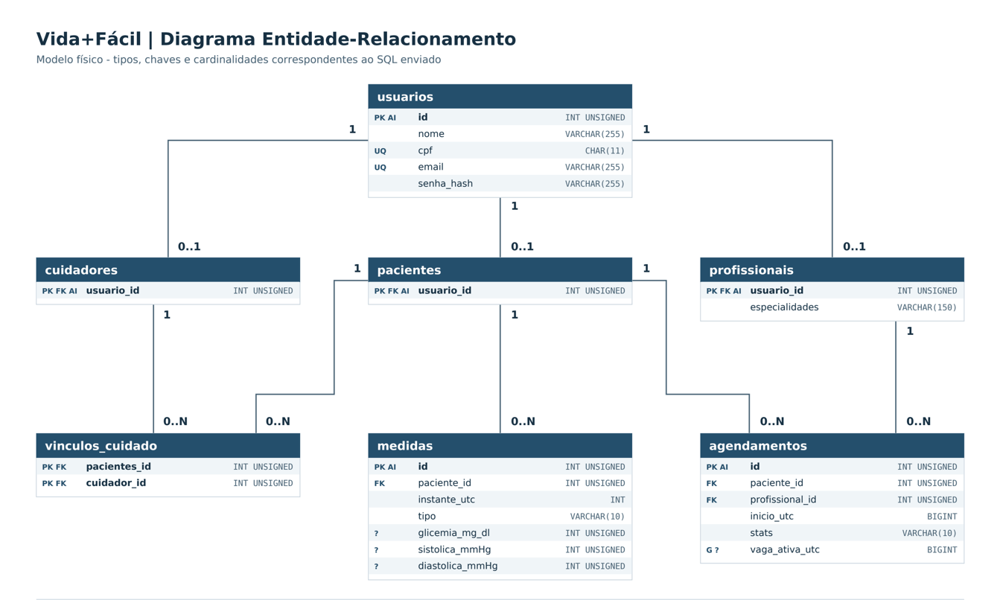
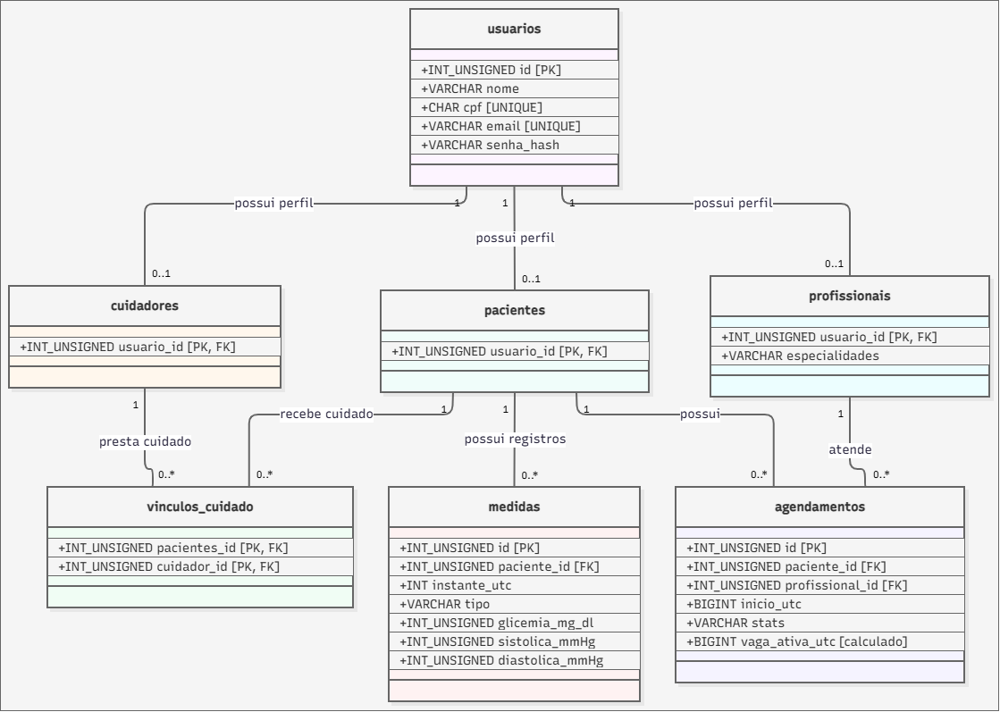

## 1 - Problema encontrado

Pessoas podem ter dificuldades para encontrar informações sobre saúde, ter acompanhamento com profissionais da área e acompanhar seus indicadores (pressão, frequência cardiaca, glicemia)

____________________________________________________________________________________________

## 2 - Solução encontrada

Criar uma plataforma interativa e de fácil acesso para todas as idades onde profissionais possam interagir com seus pacientes através de consultas que podem ser agendadas pela propria plataforma.

____________________________________________________________________________________________

## 3 - Certezas / Sugestões / Dúvidas

## Certezas 

* O público irá incluir idosos e profissionais de saúde;
* É indispensável que a plataforma tenha cadastro e login (paciente e profissionais);
* Deve haver agendamento de consulta pela própria plataforma.

## Sugestões 

* Uma quantidade abrangente de usuários não está familiarizada com a internet;
* Tela acessível (sem textos pequenos e muitas informações na tela) para usuários com dificuldades de leitura;
* Lembretes para o usúario realizar um registro (diário ou semanal) após realizar alguma atividade física.

## Dúvidas

* Os profissionais de saúde terão acesso aos dados de seus pacientes?
* Os dados mostrados serão apenas exemplo ou reais?
* Como será feito o acompanhamento residencial após as consultas?

____________________________________________________________________________________________

## 4 - Personas

#### Paciente 
* Maria Josefa - 70 anos
* "Preciso de uma plataforma de fácil acesso que me ajude a acompanhar meus dados de saúde e que me ajude a realizar consultas"
* Familiarizada com a internet, passa o dia no whatsapp e pesquisando receitas online.
* Dificuldades: Tem problemas com cores muito fortes, termos técnicos, letras muito pequenas e telas cheias de informações desnecessárias.

#### Profissional de saúde / Médica
* Dra. Ana Paula - 37 anos;
* "Preciso de uma ferramenta que me ajude com meus atendimentos";
* Gerenciar seu próprio horário; 
* Consultar seus agendamentos.

#### Responsável pelo paciente / Cuidador 
* José Pinheiro - 29 anos
* "Preciso ajudar minha mãe a manter os cuidados com sua saúde mesmo com a rotina apertada"
* Auxiliar nos agendamentos;
* Evitar esquecimentos; 
* Acompanhar a rotina de cuidados com sua mãe;
____________________________________________________________________________________________

## 5 - Mapa de navegação 

____________________________________________________________________________________________

## 6 - Requisitos funcionais ( O sistema DEVE fazer )

### Alta prioridade

* Permitir entrada (Login) e saída (Logout);
* Permitir cadastro de novos usuarios;
* Verificação de disponibilidade de horário do profissional;
* Registro de informações de saúde (Pressão / glicemia); 
* Agendamento de consultas de modo fácil.

____________________________________________________________________________________________

## 7 - Requisitos não funcionais 

### Alta prioridade
* O sistema deve possuir uma interface intuitiva;
* Adaptação para computadores, tablets e smartphones;
* O sistema deve restringir acesso à informações de acordo com as permissões do tipo de usuário;
* O sistema deve armazenar senhas de maneira encriptada (ByCript, Hash); 
____________________________________________________________________________________________

## 8 - Matriz de casos de uso

____________________________________________________________________________________________

## 9 - Jornada do Usuário

 

____________________________________________________________________________________________

## 10 - Justificativa de design 
O design é voltado para o alto contraste e fontes de fáceis compreensão para auxiliar pessoas da terceira idade, foram utilizadas fontes em tamanho grande para evitar dificuldades na vista.
____________________________________________________________________________________________

## 11 - DER ( Diagrama de entidade e relacionamento)

____________________________________________________________________________________________

## 12 - Diagrama de Classes 

